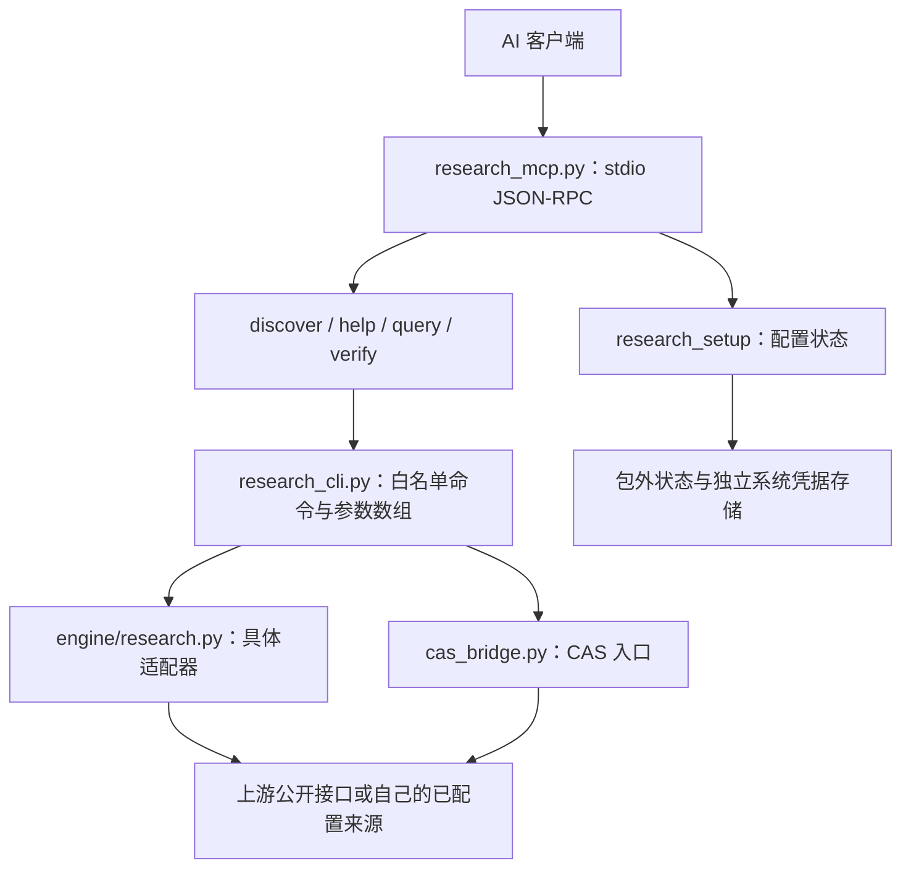

# 架构与开发说明

[返回首页](../README.md) · [使用示例](EXAMPLES.md) · [数据源清单](DATA_SOURCES.md)

## 请求路径



服务使用按行分隔的 stdio JSON-RPC，标准输出用于协议。它不是 HTTP/SSE 托管服务，不包含一个自动控制任意浏览器的通用驱动。

## 主要文件

| 文件/目录 | 职责 |
|---|---|
| `src/research_mcp.py` | MCP 初始化、工具列表、参数分发及协议返回 |
| `src/research_cli.py` | 命令目录检查、模式门控、子进程调用、错误分类和输出包装 |
| `src/onboarding.py` | 来源配置步骤、状态、跳过、暂停恢复及测试记录 |
| `src/release_runtime.py` | 状态路径、系统凭据命名空间、环境/缓存隔离及脱敏辅助 |
| `src/engine/research.py` | 汇总 CLI 参数解析与适配器调用 |
| `src/engine/*.py` | 数据源查询、公开文件解析等具体适配器 |
| `src/engine/*.mjs` | 需要外部浏览器执行环境的页面/响应辅助模块 |
| `src/data/command_catalog.json` | 可发现命令及静态需求提示 |
| `install.py` | 包外版本副本、虚拟环境和连接配置生成 |
| `src/distribution.py` / `MANIFEST.sha256` | 发行文件白名单及哈希 |
| `tools/pack_release.py` / `tools/verify_manifest.py` | 清单导出与严格发行校验 |
| `tests/test_core.py` / `tests/test_distribution.py` | 离线功能及分发隔离检查 |

## 工具参数

完整输入 schema 可通过 MCP `tools/list` 获取，以下是主要字段。不要把密码、密钥或 Cookie 作为工具参数传入。

| 工具 | 主要字段 |
|---|---|
| `research_setup` | `action`：status/next/select/mark/skip/pause/resume/network_status/network_reset；按动作使用 mode/source/step |
| `research_discover` | keyword，limit 1—40，starter_only、available_only（默认 true），可选 kind 返回层级 |
| `research_help` | command |
| `research_query` | command，args 字符串数组（最多 40 项，每项最多 4,000 字符） |
| `research_verify` | source，使用向导内该来源的固定示例查询 |

`research_query` 通过参数数组启动 Python，不把输入拼成 shell。客户端不需要为几千个命令逐一注册工具，新版使用七个统一入口。

`research_discover` 是本地命令索引的关键词匹配，带部分中文别名扩展，不是联网语义检索或完整来源健康检查。建议用“统计”“学术”“世界银行”等主题或具体命令/来源词发现，再查看 help。

## 返回结构

MCP 调用结果的 `content` 包含文本块，文本内容是工具返回的 JSON。客户端通常会处理这一层；以下是研究查询的**结构示意**，不是一次真实查询结果：

```json
{
  "ok": true,
  "command": "command-name",
  "result": {},
  "requirements": {},
  "source": "research-mcp",
  "verification": "说明本次返回的验证范围"
}
```

具体来源的原始结构保留在 `result` 中，可能是数组或对象，不会统一强制改成同一种表。必须继续解释其中的单位、编码、时间、分页、警示和缺失值。

常见失败返回包含 `ok: false`、`error`、`message`，部分带 `hint` 或 `requirements`。工具层的成功不等同于完整研究结论；例如发现接口可能只扫描了部分目录，结果字段中仍会记录失败页或截断信息。

默认执行超时约 90 秒，输出有约 150 万字符上限；应优先缩小筛选范围并分页，而不是一次请求全库。

## 本地 CLI

可用安装后的 Python 调用运行副本：

```sh
python3 -B research_cli.py crossref "renewable energy" --rows 3
```

这只是说明脚本与参数关系；实际运行时使用安装器输出的真实路径，并保留与 MCP 相同的 `RESEARCH_MCP_STATE_DIR`。CLI 与 MCP 都受模式和命令目录检查约束。

## 可用性与元数据

`access_policy.py` 按 general/zju/login 门控；starter 仅是起步样例。`tools/build_access_catalog.py` 通过命令分支及可达函数扫描访问条件，避免整个模块传递误标；标记仍是静态提示；并不声明当前学校已授权或上游始终可用。新增适配器既需要实际查询验证，也需要完整的参数、分页、错误与来源说明。

## 扩展一个来源的建议流程

1. 明确官方入口、查询范围、需要的身份和数据口径。
2. 实现可复用的查询/解析模块，检查返回结构、分页、错误页和缺失值。
3. 在 `src/engine/research.py` 添加 CLI 入口与分发；参数使用明确的类型、数量和范围。
4. 更新 `src/data/command_catalog.json` 的模块、需求和 readiness。不要仅因为能打开首页就放入 starter。
5. 用少量真实请求验证预期行为，记录“网页/API/全文”分别验证到什么程度；提交日志不包含真实凭据或用户数据。
6. 补上来源与使用示例；涉及认证流程或非平凡错误处理时增加相应有意义的检查。
7. 发布前先做隐私审计，再按许可文件范围重建发行清单、打包并回下载核验。不要通过盲目更新哈希绕过失败检查。

`src/distribution.py` 对可分发根文件和文档路径采用明确白名单；单纯新增文件不会自动被打包，这是避免运行状态或私人文件混入的设计。

## 验证与提交问题

对解压后的干净发行包运行：

```sh
python3 -B tools/verify_manifest.py
python3 -B -m unittest discover -s tests -v
python3 -B tests/test_distribution.py
```

源码工作目录含 `.git` 时，严格校验会报告额外文件；可先用 `tools/pack_release.py` 导出、解压到临时目录再验证。离线检查不替代所有源站的实时验收。

提交 issue/PR 时只附可公开的最小复现条件和脱敏错误，不上传个人配置、令牌、会话、机构证明、下载材料或私人研究结果。先尊重用户现有配置，再处理目标来源。

## v1.2.0：错误契约与质量检查

`diagnostics.py` 统一生成简短参数错误和脱敏来源诊断。参数错误保留 `usage`/`supported_options`，数值数量参数可从起步命令的 `count_option` 读取。MCP 工具共七个，查询结果补充 `result_kind`、`partial` 和必要的 `warnings`。

网络异常只添加诊断，不改变已确认正常的适配器传输逻辑。`tools/doctor.py` 提供版本/环境及单命令检查；`tools/public_check.py` 是显式运行的公开样例检查，使用临时 general 状态（兼容旧 partial 别名），不读取用户实际凭据、不保存研究内容。

```sh
python3 -B tests/test_diagnostics.py
python3 -B tools/public_check.py --suite all --output /path/outside/package/validation.json
```

网络检查结果受来源状态影响，不与离线回归混为一谈。GitHub Actions 在 Linux、macOS、Windows 运行离线检查，并在 Linux 抽样请求公开接口；联网失败会写入独立报告，不能只看工作流的绿色状态判断所有来源可用。

## v1.3.0：模式、状态迁移与网络跳过

状态 schema 2 支持 general/zju/login。加载 schema 1 时仅规范化模式（partial→general、full→login），保存时使用 schema 2，不删除 progress、paused、active_source 或凭据。未选择模式仍先提示选择；新安装默认 general。

query 先检查权限、做离线语法校验，再查短暂网络等待缓存并实际执行。RESEARCH_MCP_VALIDATE_ONLY 仅供内部语法检查，不查询网络或凭据；参数错误优先于网络等待。实际 DNS/连接/代理/TLS/超时错误由 network_health.py 记录 60 秒；查询返回 skipped，discover 默认过滤同一命令，AI 应继续其他来源。不同命令及 HTTP 拒绝/限流不被泛化禁用；network_reset 清除等待不影响配置进度。少数旧适配器只提供通用错误时不猜测其网络状态。

运行 `python3 -B tools/build_access_catalog.py` 可复建命令静态分类。network_hosts 为代码引用的主机提示，可能包含文档/命名空间，**不作为预探测清单或批量封禁依据**。network-health.json 只存实际失败命令、脱敏类型、可选主机名和重试时间，位于包外。

## v1.4.0查询效率

新增batch_query.py、result_store.py、research_sdk.py；两项新工具沿用原模式与凭据门控。静态目录缓存；结果不缓存为查询答案，auto仅在大结果时导出本次完整返回。导出在包外，按随机编号白名单读取；SDK通过上下文状态目录传给子进程，避免不同客户端串用配置。安装器只在自己虚拟环境注册SDK路径，config-only不动系统Python。详见[批量与导出](PRODUCTIVITY.md)。

## v1.4.1目录整理

仓库根目录仅保留README、安装入口、AI规则和发行校验文件。实际服务、SDK与数据库适配器在src/，命令索引位于src/data/，文档在docs/，测试在tests/，维护脚本在tools/。`python3 -B install.py`保持兼容；安装器生成新的src/research_mcp.py连接路径和SDK导入路径。状态目录及系统凭据命名空间不迁移、不重置。

统一测试：`python3 -B -m unittest discover -s tests -v`。维护脚本可从仓库根目录运行，例如 `python3 -B tools/pack_release.py`。旧版本的安装副本继续保留；升级后要更新连接并重连。
