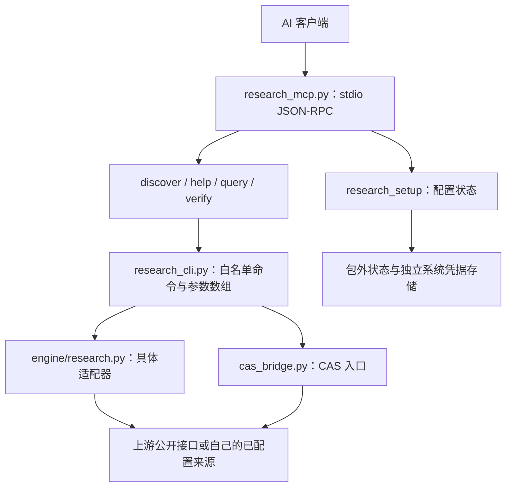

# 架构与开发说明

[返回首页](../README.md) · [使用示例](EXAMPLES.md) · [数据源清单](DATA_SOURCES.md)

## 请求路径



服务使用按行分隔的 stdio JSON-RPC，标准输出用于协议。它不是 HTTP/SSE 托管服务，不包含一个自动控制任意浏览器的通用驱动。

## 主要文件

| 文件/目录 | 职责 |
|---|---|
| `research_mcp.py` | MCP 初始化、工具列表、参数分发及协议返回 |
| `research_cli.py` | 命令目录检查、模式门控、子进程调用、错误分类和输出包装 |
| `onboarding.py` | 来源配置步骤、状态、跳过、暂停恢复及测试记录 |
| `release_runtime.py` | 状态路径、系统凭据命名空间、环境/缓存隔离及脱敏辅助 |
| `engine/research.py` | 汇总 CLI 参数解析与适配器调用 |
| `engine/*.py` | 数据源查询、公开文件解析等具体适配器 |
| `engine/*.mjs` | 需要外部浏览器执行环境的页面/响应辅助模块 |
| `command_catalog.json` | 可发现命令及静态需求提示 |
| `install.py` | 包外版本副本、虚拟环境和连接配置生成 |
| `distribution.py` / `MANIFEST.sha256` | 发行文件白名单及哈希 |
| `pack_release.py` / `verify_manifest.py` | 清单导出与严格发行校验 |
| `self_check.py` / `test_distribution.py` | 离线功能及分发隔离检查 |

## 工具参数

完整输入 schema 可通过 MCP `tools/list` 获取，以下是主要字段。不要把密码、密钥或 Cookie 作为工具参数传入。

| 工具 | 主要字段 |
|---|---|
| `research_setup` | `action`：status/next/select/mark/skip/pause/resume；按动作使用 mode/source/step |
| `research_discover` | keyword，limit 1—40，starter_only |
| `research_help` | command |
| `research_query` | command，args 字符串数组（最多 40 项，每项最多 4,000 字符） |
| `research_verify` | source，使用向导内该来源的固定示例查询 |

`research_query` 通过参数数组启动 Python，不把输入拼成 shell。客户端不需要为几千个命令逐一注册工具，只需使用五个统一入口。

`research_discover` 是本地命令索引的关键词匹配，带部分中文别名扩展，不是联网语义检索或完整来源健康检查。建议用“统计”“学术”“世界银行”等主题或具体命令/来源词发现，再查看 help。

## 返回结构

MCP 调用结果的 `content` 包含文本块，文本内容是工具返回的 JSON。客户端通常会处理这一层；以下是研究查询的**结构示意**，不是一次真实查询结果：

```json
{
  "ok": true,
  "command": "command-name",
  "result": {},
  "requirements": {},
  "source": "research-mcp",
  "verification": "说明本次返回的验证范围"
}
```

具体来源的原始结构保留在 `result` 中，可能是数组或对象，不会统一强制改成同一种表。必须继续解释其中的单位、编码、时间、分页、警示和缺失值。

常见失败返回包含 `ok: false`、`error`、`message`，部分带 `hint` 或 `requirements`。工具层的成功不等同于完整研究结论；例如发现接口可能只扫描了部分目录，结果字段中仍会记录失败页或截断信息。

默认执行超时约 90 秒，输出有约 150 万字符上限；应优先缩小筛选范围并分页，而不是一次请求全库。

## 本地 CLI

可用安装后的 Python 调用运行副本：

```sh
python3 -B research_cli.py crossref "renewable energy" --rows 3
```

这只是说明脚本与参数关系；实际运行时使用安装器输出的真实路径，并保留与 MCP 相同的 `RESEARCH_MCP_STATE_DIR`。CLI 与 MCP 都受模式和命令目录检查约束。

## 可用性与元数据

`starter` 决定 partial 是否允许执行。其他静态标记来自源代码/模块依赖扫描，可能粗略；并不声明当前学校已授权或上游始终可用。新增适配器既需要实际查询验证，也需要完整的参数、分页、错误与来源说明。

## 扩展一个来源的建议流程

1. 明确官方入口、查询范围、需要的身份和数据口径。
2. 实现可复用的查询/解析模块，检查返回结构、分页、错误页和缺失值。
3. 在 `engine/research.py` 添加 CLI 入口与分发；参数使用明确的类型、数量和范围。
4. 更新 `command_catalog.json` 的模块、需求和 readiness。不要仅因为能打开首页就放入 starter。
5. 用少量真实请求验证预期行为，记录“网页/API/全文”分别验证到什么程度；提交日志不包含真实凭据或用户数据。
6. 补上来源与使用示例；涉及认证流程或非平凡错误处理时增加相应有意义的检查。
7. 发布前先做隐私审计，再按许可文件范围重建发行清单、打包并回下载核验。不要通过盲目更新哈希绕过失败检查。

`distribution.py` 对可分发根文件和文档路径采用明确白名单；单纯新增文件不会自动被打包，这是避免运行状态或私人文件混入的设计。

## 验证与提交问题

对解压后的干净发行包运行：

```sh
python3 -B verify_manifest.py
python3 -B self_check.py
python3 -B test_distribution.py
```

源码工作目录含 `.git` 时，严格校验会报告额外文件；可先用 `pack_release.py` 导出、解压到临时目录再验证。离线检查不替代所有源站的实时验收。

提交 issue/PR 时只附可公开的最小复现条件和脱敏错误，不上传个人配置、令牌、会话、机构证明、下载材料或私人研究结果。先尊重用户现有配置，再处理目标来源。
